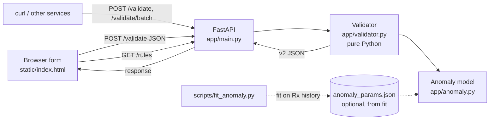
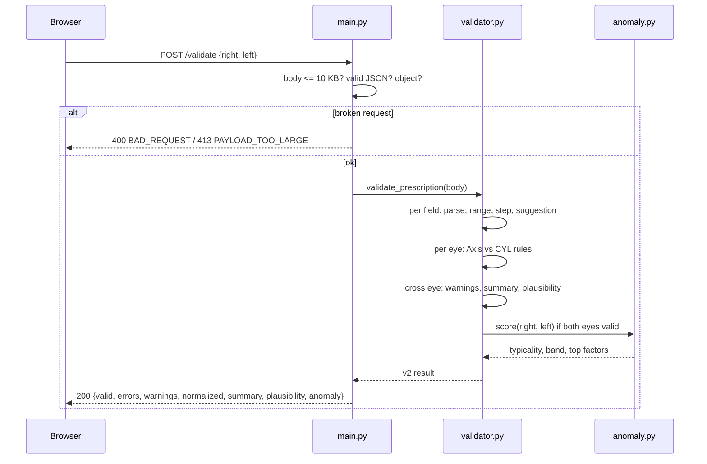
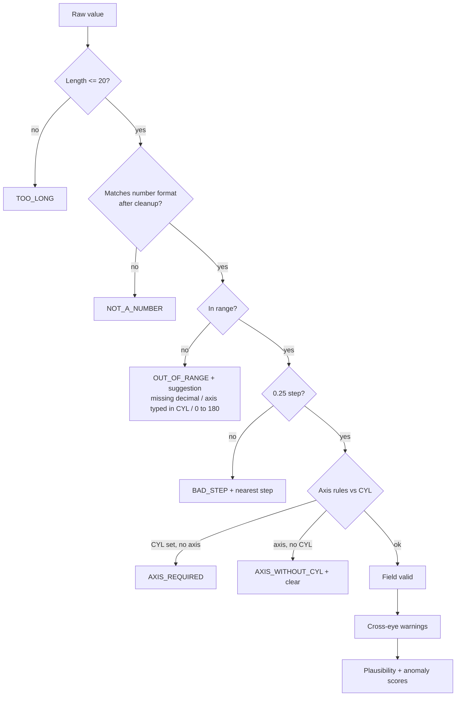
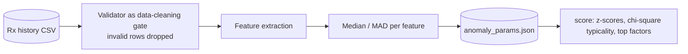
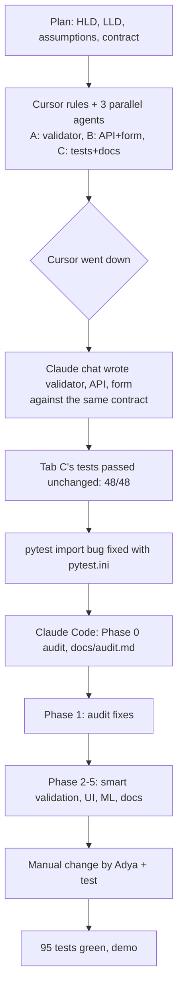

# Rx Validator: the book

Everything about this project in one place: the problem, what was built, why, how, and how it was built with AI.

## 1. Problem statement (as given)

Build a working service or app that validates prescription inputs (left and right eye SPH, CYL, Axis) against plausible ranges and returns clear, specific errors. It must run at a shareable URL (localhost is fine), survive bad or empty input, and show at least one place where the AI's output was changed by hand. Time box: 20 to 25 minutes.

**Definition of done:** open it in a browser, feed it bad input, watch it reject it with specific errors.

## 2. What was built (beyond the statement)

| Asked for | Built |
|---|---|
| Validate SPH/CYL/Axis ranges | Ranges, 0.25 D steps, whole-number Axis 1 to 180, Axis/CYL dependency rules |
| Clear, specific errors | Every error names eye, field, allowed range and the value received, with a machine-readable code |
| Survive bad/empty input | Strict parser, length caps, body size cap, never an unhandled 500 (95 tests) |
| Working URL | FastAPI on localhost:8000, web form + JSON API + Swagger at /docs |
| One manual change | Unicode minus support, done by hand with its own test |

**Innovations (not in the statement):**
1. **"Did you mean" fixes with one click:** 1.30 -> +1.25, 125 -> +1.25 (missing decimal), axis 0 -> 180, axis 270 -> 90, an axis typed into CYL (CYL 90) -> moved to Axis.
2. **Errors vs warnings:** impossible values block; clinically unusual but possible values (anisometropia, antimetropia, high power, plus-cyl, mixed notation) warn without blocking.
3. **Clinical summary:** spherical equivalent and plus/minus cylinder transposition per eye.
4. **Two independent scores:** rule-based plausibility (0 to 100) and an **ML anomaly model** (typicality 0 to 100 with explanations).
5. **Real-world input tolerance:** comma decimals, "DS"/"D" suffixes, "x90", "90°", OD/OS keys, uppercase fields, "piano" typo.
6. **API thinking:** `/rules` (UI reads limits from the server), `/validate/batch` (clean historical records), contract-versioned responses.

## 3. Domain primer

- **SPH (sphere):** main power in dioptres. Minus = short-sighted, plus = long-sighted.
- **CYL (cylinder):** extra power for astigmatism. Blank or 0 = none.
- **Axis:** orientation of the cylinder, 1 to 180 degrees. Only meaningful when CYL is not 0.
- **Spherical equivalent (SE):** SPH + CYL/2, the single "average" power of an eye.
- **Transposition:** the same lens written in the other notation: SPH' = SPH + CYL, CYL' = -CYL, Axis' = Axis +/- 90.
- **Anisometropia:** large SE difference between eyes (here >= 2 D). **Antimetropia:** one eye minus, the other plus.
- **Mirror symmetry:** astigmatism axes are usually mirror images between eyes (right 180 with left 180, right 170 with left 10).

## 4. Assumptions

See `docs/assumptions.md` (A1 to A18). Key ones:

| # | Assumption |
|---|---|
| A1 to A3 | SPH -20 to +20 required, CYL -6 to +6 optional, both in 0.25 steps |
| A4 to A6 | Axis whole 1 to 180, required with CYL, error if given without CYL |
| A9 | Invalid Rx = HTTP 200 with valid:false. Broken request = 400/413. Never an unhandled 500 |
| A11 | Generic lab ranges, not Lenskart-specific; all are constants |
| A15 | ML model ships with illustrative priors; must be re-fitted on real data |
| A16 | Clinical flags never block |

## 5. Architecture

### High level



### Request lifecycle



### Validation pipeline



### Repository map

```
app/validator.py     domain rules, parsing, suggestions, warnings, summary, plausibility (no web code)
app/anomaly.py       ML anomaly model: features, score, fit, save, synthetic data for tests
app/main.py          FastAPI: /, /health, /rules, /validate, /validate/batch
static/index.html    form, Apply-fix buttons, warnings, summary, score bars
scripts/fit_anomaly.py  fits the model from a CSV of past prescriptions
tests/               95 tests: v1 contract (48) + v2 edge cases, suggestions, ML, API
docs/                contract, assumptions, decisions log, audit, plan, todo, this book
CLAUDE.md, rules/    context and rules for the AI agents
```

## 6. Response catalogue

**Errors (block):** REQUIRED, NOT_A_NUMBER, TOO_LONG, OUT_OF_RANGE, BAD_STEP, AXIS_NOT_INTEGER, AXIS_REQUIRED, AXIS_WITHOUT_CYL, MISSING_EYE, BAD_REQUEST (400), PAYLOAD_TOO_LARGE (413), INTERNAL (500, defensive only).

**Warnings (never block):** HIGH_POWER, ANISOMETROPIA, ANTIMETROPIA, PLUS_CYL, MIXED_CYL_NOTATION.

**Suggestions:** nearest 0.25 step; missing decimal (keeps sign); axis 0 -> 180; axis 181..360 -> axis-180; decimal axis -> rounded; CYL that looks like an axis -> move to Axis; axis without CYL -> clear.

## 7. ML component: statistical anomaly model

**Why:** rules catch impossible values. They cannot catch combinations that are each legal but unusual together. Example: both eyes CYL -1.50 at axis 45 passes every rule (plausibility 100) but breaks left/right mirror symmetry, so the model rates it **rare**.

**Features (per two-eye Rx):**

| Feature | Meaning | Unusual when |
|---|---|---|
| se_mean | average SE | far from population median (both directions) |
| se_diff | SE difference between eyes | higher |
| cyl_max | strongest cylinder | higher |
| cyl_diff | cylinder difference between eyes | higher |
| obliquity | axis distance from 90/180 | higher |
| axis_asym | break from mirror symmetry | higher |

**Model:** each feature becomes a robust z-score using median and MAD (resistant to outliers in training data). Distance d2 = sum of z squared. Typicality = P(chi-square with 6 dof >= d2) x 100. Bands: >= 30 typical, 5 to 29 uncommon, < 5 rare. The top contributing features are returned as the explanation.



**Honesty note:** no real prescription data was available, so it ships with illustrative priors (A15). `fit()` is real and tested: `python scripts/fit_anomaly.py --csv history.csv` learns every parameter from data. Next steps with real data: compare against Isolation Forest or a Gaussian mixture, calibrate bands against labelled transcription errors.

## 8. Edge cases covered

| Input | Result |
|---|---|
| empty form | REQUIRED for both SPH, no crash |
| "abc", "1e1", "nan", "inf", "--1" | NOT_A_NUMBER |
| 50-character string | TOO_LONG |
| 20 KB body | 413 PAYLOAD_TOO_LARGE |
| "not json", `[]` | 400 BAD_REQUEST |
| `{}` or missing eye | MISSING_EYE per eye |
| "-1,25", "-1.25 DS", ".75", "Plano", "piano" | accepted |
| "-0.00" | normalized to +0.00 |
| "x90", "90°", "090" | Axis 90 |
| Axis 0 / 270 / 90.4 | error + fix 180 / 90 / 90 |
| CYL 90, Axis blank | error + "move 90 to Axis" |
| CYL -7 and Axis 200 | both errors shown |
| R -1.00, L -4.00 | valid + ANISOMETROPIA warning |
| both eyes -1.50 x 45 | valid, rules 100, ML rare (mirror symmetry) |
| OD/OS keys, SPH/CYL uppercase | accepted |
| "−1.25" (Unicode minus) | accepted after the manual change |

## 9. Design decisions (summary, full log in decisions.md)

- **Contract first** (`docs/contract.md`): agents and humans code against one spec, so tools could be swapped mid-build.
- **Pure validator, thin API:** domain logic testable without a server; API only handles transport.
- **Plain `Request`, not Pydantic:** Pydantic returns a generic 422; we need field-level, human messages.
- **200 for an invalid Rx:** validation ran fine, the answer is "no". 4xx is for requests we cannot process.
- **Text inputs, not number inputs:** the browser must not filter input, so the server is what rejects it.
- **`round(v*4)` not modulo:** float modulo is unreliable for 0.25 checks.
- **Strict regex, not `float()`:** `float()` accepts "1e1", "nan", "inf".
- **Warnings never block:** unusual Rx can be correct; a human should check, not be blocked.
- **Two scores, not one:** rule flags and statistical rarity are different signals and should be visible separately.
- **No new dependencies:** ML written in pure Python so the stack stayed FastAPI + pytest.

## 10. How it was built (AI workflow)



- Every agent decision is logged in `docs/decisions.md` with **why** and **alternative rejected**.
- `docs/todo.md` has an **AI quality checklist** (no weakened tests, no new deps, contract updated before code, agent pasted real test output).
- The audit step caught real issues: missing range text in messages, contract drift, axis errors hidden behind CYL errors.

## 11. Manual change (human in the loop)

**Problem found:** prescriptions copied from PDFs or WhatsApp often use the Unicode minus sign (U+2212) instead of `-`. The AI-written parser rejected a valid Rx like "−1.25" as NOT_A_NUMBER.

**Fix by hand (app/validator.py, parse_power):** normalise U+2212 and en dash to `-` before parsing, plus a test in tests/test_v2.py. Logged in decisions.md as `[Adya, manual]`.

## 12. Testing

`python -m pytest -q`: 95 tests (48 original v1 contract tests unchanged + 47 v2), plus the manual-change test. Covers every error code, every suggestion, every warning, summary math, ML scoring and fitting, API limits and batch.

## 13. Run and demo

```bash
pip install -r requirements.txt
uvicorn app.main:app --reload --port 8000     # open http://localhost:8000 and /docs
python -m pytest -q
python scripts/fit_anomaly.py --synthetic 5000 --dry-run   # shows the fit pipeline
```

## 14. Limitations and next steps

- Ranges are generic, not per lens type; next: read limits from Lenskart's lens catalogue.
- ML priors are illustrative; next: fit on real Rx history, compare with Isolation Forest, calibrate bands.
- No ADD, PD, prism, or near-vision fields yet.
- Next: OCR of Rx photos with this validator as the guardrail on OCR output; analytics on which errors users hit most.
